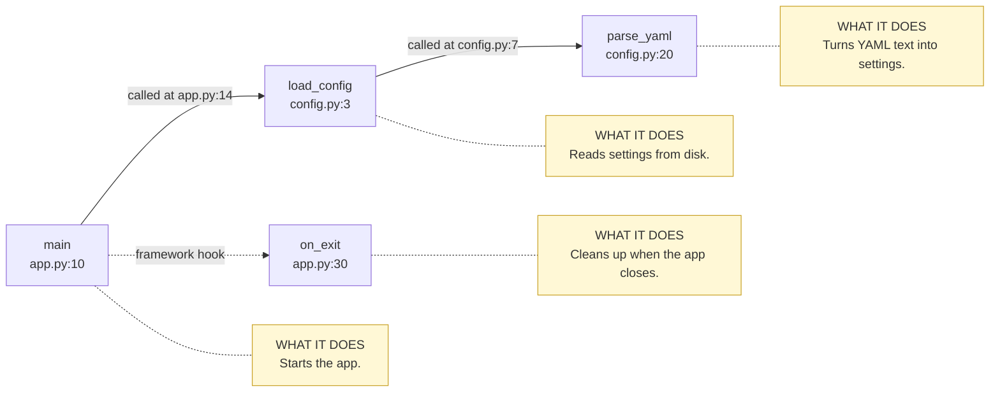
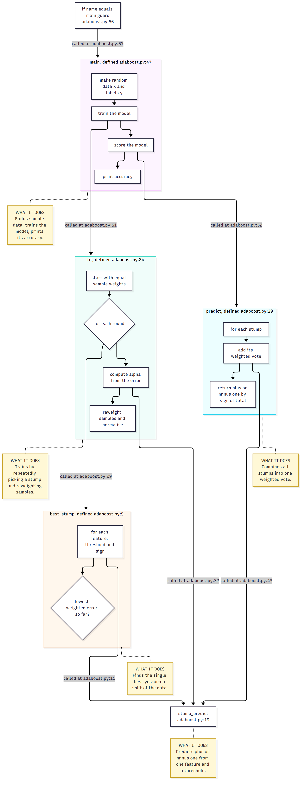

# codegraph-tracer

A Claude Code plugin with two slash commands for exploring a codebase through [CodeGraph](https://github.com/colbymchenry/codegraph), a code-indexing tool.

> **Not affiliated with CodeGraph.** This is an unofficial, community plugin. It is not made, endorsed or supported by the CodeGraph authors. "CodeGraph" is used only to say what the commands work with.

## What it does

- **`/cg-trace <function, method or test>`** traces a symbol with CodeGraph, checks every call against the source, and draws one Mermaid call graph with a short summary (4 bullets or fewer).
- **`/cg-ask <question>`** answers a question about the codebase using CodeGraph, with `file:line` references and no diagram unless you ask.

## Requirements

- Claude Code
- CodeGraph and its MCP server, configured in Claude Code
- A `.codegraph/` index in the project. Without one, the commands say so and fall back to Read/Grep.
- Note: **The index is a database CodeGraph builds ahead of time by scanning your project's source code.** It's stored in a **.codegraph/ folder at the project root.** It is a map of the code, including every function, class and method, where each is defined (file and line), and which ones call which. CodeGraph (the tool) builds it. 

## Install

> **Install CodeGraph first.** This plugin only adds the two commands. It does not include CodeGraph. Install CodeGraph and its MCP server by following [its own instructions](https://github.com/colbymchenry/codegraph), then run `codegraph init -i .` in your project to build the index.

```
/plugin marketplace add sedy2014/codegraph-tracer
/plugin install codegraph-tracer@sedy2014-tools
```

### Scope: the plugin is global, the index is per project

By default the plugin installs for your user, so `/cg-trace` and `/cg-ask` are available in every project. To limit it to one project or share it with a team, choose a scope when installing:

```
claude plugin install codegraph-tracer@sedy2014-tools --scope project
```

(`user` is the default, `project` is shared through the repo's settings, and `local` is just for you in that repo.)

CodeGraph's index is always per project. In each project where you want to use the commands, run `codegraph init -i .` once. In a project without a `.codegraph/` folder, the commands say so and fall back to Read/Grep.

## Usage

```
/cg-trace main
/cg-trace test_login_redirect
/cg-ask what does load_config do with the settings file?
/cg-ask which functions run when the app exits?
```

The first example, `/cg-trace main`, produces the sample diagram below.

If your Claude Code version namespaces plugin commands, use `/codegraph-tracer:cg-trace` and `/codegraph-tracer:cg-ask`.

## Sample output for `/cg-trace main`

Each function gets a "WHAT IT DOES" note. Solid arrows are verified in the source; dashed arrows are inferred.



## Worked example

[examples/adaboost/](examples/adaboost/) holds a small AdaBoost script. Indexing it with `codegraph init -i .` and running `/cg-trace main` gives this call graph (source: [trace-main.mmd](examples/adaboost/trace-main.mmd)):



## License

Apache License 2.0. See [LICENSE](LICENSE).
